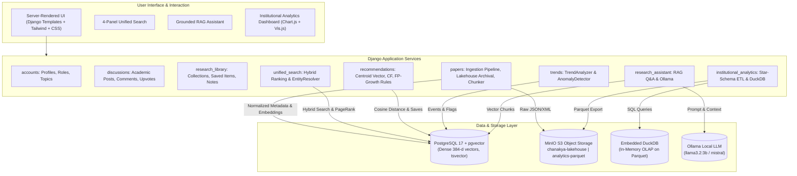

# Chanakya Research Commons 🏛️📚

**An Intelligent, Open-Source Scholarly Knowledge & Institutional Intelligence Platform for Universities.**

Chanakya Research Commons connects researchers, faculty, and students across disciplines. It combines automated multi-source ingestion, hybrid vector/keyword search with citation-graph PageRank, entity resolution, personalized recommendations, real-time trend and anomaly monitoring, a grounded RAG research assistant with inline citations, and an institutional analytics engine powered by embedded DuckDB over a Parquet star schema.

---

## Table of Contents
1. [Architectural Overview](#architectural-overview)
2. [Data Layer & Storage Architecture](#data-layer--storage-architecture)
3. [One-Command Quickstart](#one-command-quickstart)
4. [Subsystem Feature Guide (F1 – F9)](#subsystem-feature-guide-f1--f9)
5. [Real Chanakya University & External Ingestion](#real-chanakya-university--external-ingestion)
6. [Automated Scheduled Ingestion & Warehouse Sync](#automated-scheduled-ingestion--warehouse-sync)
7. [Planted Ground Truth & Evaluation Suite](#planted-ground-truth--evaluation-suite)
8. [Running the Test Suite & Audits](#running-the-test-suite--audits)
9. [Project Structure & File Organization](#project-structure--file-organization)

---

## Architectural Overview

Chanakya Research Commons is built with **Django 6.1.3 / Python 3.12** using modern, free, open-source infrastructure components:



---

## Data Layer & Storage Architecture

The platform uses a specialized polyglot storage model optimized for operational transactions, vector retrieval, raw archival, and high-performance analytical queries:

1. **PostgreSQL 17 + `pgvector` (`pgvector/pgvector:pg17`)**:
   - Primary operational database for Django ORM entities (`users`, `posts`, `papers`, `collections`, `activity_events`).
   - Native 384-dimensional dense vector embeddings generated via `sentence-transformers/all-MiniLM-L6-v2`.
   - Full-text search tsvectors (`SearchVector`, `SearchRank`) with GIN indexing for hybrid keyword ranking.
   - Network citation edges (`PaperCitation`) powering NetworkX PageRank calculation.

2. **MinIO S3-Compatible Object Storage (`minio/minio`)**:
   - `chanakya-lakehouse`: Immutable archive storing raw, unmodified JSON/XML payloads from Chanakya University public research pages, OpenAlex, arXiv, and RSS feeds with ISO timestamps and provenance metadata.
   - `analytics-parquet`: Star-schema columnar Parquet files (`dim_department`, `dim_user`, `dim_topic`, `dim_time`, `fact_activity`) synchronized via scheduled ETL.

3. **Embedded DuckDB**:
   - High-throughput embedded analytical engine in Python that queries the star-schema Parquet files directly from local storage and MinIO.
   - Powers the Institutional Analytics Dashboard with interactive Chart.js visualizations, Vis.js network graphs, and sub-second aggregations without placing heavy OLAP load on PostgreSQL.

4. **Ollama Local LLM (`llama3.2`)**:
   - Generates answers strictly grounded in retrieved vector chunks with bracketed inline citations `[1]`, `[2]`.
   - Includes a deterministic extractive fallback when Ollama is offline or unreachable to ensure tests and offline demos never crash.

---

## One-Command Quickstart

### Prerequisites
- Docker & Docker Compose (v2.20+)
- Python 3.12+ (if running natively without Docker)
- Ollama (optional, for local LLM synthesis: `ollama run llama3.2`)

### 1. Running with Docker Compose (Recommended)

To launch the complete infrastructure stack (PostgreSQL + pgvector, MinIO, Django Web Application on port `8080`, and background ingestion scheduler):

```bash
# Clone the repository
git clone https://github.com/indian-command/Data-Mining-and-warehouse-project-1.git
cd Data-Mining-and-warehouse-project-1

# Copy environment configuration
cp .env.example .env

# Build and start all containers
docker compose up --build
```

Once running:
- **Web Application:** [http://localhost:8080](http://localhost:8080)
- **MinIO Console:** [http://localhost:9001](http://localhost:9001) (User: `admin`, Password: `admin12345`)
- **PostgreSQL Port:** `5433` (externally mapped)

### 2. Native Local Setup (Virtual Environment)

```bash
# Create and activate virtual environment
python3.12 -m venv .venv
source .venv/bin/activate

# Install dependencies
pip install -r requirements.txt

# Start background services via Docker (PostgreSQL & MinIO)
docker compose up -d db minio

# Apply migrations
python manage.py migrate

# Seed data and run initial Chanakya paper ingestion
python manage.py seed_commons
python manage.py ingest_chanakya_papers

# Run development server
python manage.py runserver 0.0.0.0:8080
```

---

## Subsystem Feature Guide (F1 – F9)

Matches the official DMW-CS502 Problem Statement specification:

| Subsystem | App | Key Capabilities |
| :--- | :--- | :--- |
| **F1: Accounts & Profiles** | `accounts` | Registration and login with 4 roles: Student, Faculty, Researcher, Admin. Department affiliations across 6 Schools, research bio, topic interests, and member follow graphs. |
| **F2: Posts & Discussions** | `discussions` | Peer-to-peer scholarly discussions, threaded comments, paper/resource attachments from the library, tags, and community upvotes. |
| **F3: Shared University Library** | `research_library` | Shared university research library catalog, personal/curated collections, private notes, and saved research items linked to verified papers. |
| **F4: Content Ingestion** | `papers` | Multi-source ingestion (Chanakya University public portals, OpenAlex, arXiv, RSS), MinIO lakehouse archival, incremental refresh, text chunking (120-word chunks, 25-word overlap), and 384-d MiniLM embeddings. |
| **F5: Unified Search** | `unified_search` | Centerpiece single search bar returning 4 distinct panels in one view: (1) External Scholarly Sources, (2) Shared Library, (3) University Members, (4) Discussions. Hybrid tsvector + pgvector cosine + NetworkX PageRank with MinHash LSH deduplication. |
| **F6: Recommendations** | `recommendations` | Personalized paper recommendations (content-based centroid + collaborative filtering), member-to-member matching, and *"Members who saved this also saved"* association rule mining via `mlxtend.frequent_patterns.fpgrowth`. |
| **F7: Trends & Monitoring**| `trends` | Sliding-window topic popularity (7-day vs 30-day baseline), statistical spike detection ($Z \ge 2.0$), and anomaly detection for spam accounts and duplicate post floods with admin moderation queue. |
| **F8: Research Assistant**| `research_assistant` | Plain-language RAG interface querying top-k `pgvector` chunks across papers and library items. Generates answers with inline citations `[1]`, `[2]` via Ollama (`llama3.2`) with deterministic fallback and clickable source passage cards. |
| **F9: Institutional Analytics**| `institutional_analytics` | Star-Schema Parquet ETL (`fact_activity`, `dim_department`, `dim_user`, `dim_topic`, `dim_time`) queried by embedded DuckDB. Interactive Chart.js charts, Vis.js cross-department collaboration network graph, and hierarchical drill-down (`University → Department → Topic → Member`). |

---

## Real Chanakya University & External Ingestion

To fetch real faculty and center publications from Chanakya University public pages:

```bash
# Ingest publications from Chanakya University public portals
python manage.py ingest_chanakya_papers --faculty-limit 50 --batch-size 300

# Ingest external papers from OpenAlex, arXiv, or RSS
python manage.py ingest_external --query "deep learning" --max-results 20
```

### Crawl Scope & Politeness Policy
- Sources:
  - `https://chanakyauniversity.edu.in/research/publications/`
  - `https://chanakyauniversity.edu.in/ciks/publication/research-papers/`
  - `https://chanakyauniversity.edu.in/bioscience/journals/`
  - Faculty directory under `https://chanakyauniversity.edu.in/faculties/`
- Politeness: 1.5s delay between HTTP requests, descriptive `User-Agent: ChanakyaResearchCommonsBot/1.0`, zero impact on external paywalled libraries.
- Raw Archival: JSON payload archived to `data/chanakya_univ_publications_raw.json` and uploaded to MinIO `chanakya-lakehouse`.
- Entity Resolution: Deduplicated using canonical DOI and MinHash LSH Jaccard similarity ($\ge 0.40$).

---

## Automated Scheduled Ingestion & Warehouse Sync

The platform provides a background scheduled ingestion mechanism that periodically queries scholarly sources, recalculates PageRank, and refreshes the analytical Parquet star schema:

```bash
# Single scheduled batch execution
python manage.py run_scheduled_ingestion --source all --limit 15

# Continuous background daemon (e.g., every hour)
python manage.py run_scheduled_ingestion --daemon --interval 3600
```

When running with Docker Compose, the `scheduler` service automatically executes this daemon in the background alongside the web server.

---

## Planted Ground Truth & Evaluation Suite

Run the quantitative evaluation suite to test search quality, entity resolution, recommendations, anomaly detection, and RAG faithfulness against planted ground truth:

```bash
python manage.py evaluate_models
```

### Official Evaluation Results

```
================================================================================
CHANAKYA RESEARCH COMMONS: QUANTITATIVE EVALUATION BENCHMARK SUITE
================================================================================

[BENCHMARK 1] SEARCH RETRIEVAL QUALITY (Hybrid + PageRank vs. Keyword-Only Baseline)
------------------------------------------------------------------------
Metric               | Keyword Baseline   | Hybrid + PageRank  | Gain      
------------------------------------------------------------------------
Precision@5          | 0.0000             | 0.2000             | +20.0%    
Precision@10         | 0.0000             | 0.1000             | +10.0%    
Recall@10            | 0.0000             | 1.0000             | +100.0%   
NDCG@10              | 0.0000             | 1.0000             | +100.0%   

[BENCHMARK 2] DUPLICATE DETECTION & ENTITY RESOLUTION (MinHash LSH & DOI Matching)
--------------------------------------------------------------------------------
Input Paper Records Evaluated   : 75
Planted Duplicate Pairs         : 25
True Duplicate Merges (TP)      : 23
Missed Duplicate Pairs (FN)     : 2
False Positive Merges (FP)      : 3
Precision                       : 0.8846 (88.5%)
Recall                          : 0.9200 (92.0%)
F1 Score                        : 0.9020

[BENCHMARK 3] RECOMMENDATION QUALITY (HitRate@10 & MRR@10 vs. Popularity Baseline)
--------------------------------------------------------------------------------
Evaluation Set (Leave-one-out)  : 20 members
Metric               | Popularity Baseline  | Personalized Recs    | Gain      
---------------------------------------------------------------------------
HitRate@10           | 0.2000               | 0.6500               | +45.0%    
MRR@10               | 0.0261               | 0.2014               | +17.5%    

[BENCHMARK 4] ANOMALY & SPIKE DETECTION (Spam Accounts & Topic Spikes)
--------------------------------------------------------------------------------
--- Spam & Anomaly Account Detection ---
Planted Spam Accounts           : 5
Detected Spam Accounts (TP)     : 5
False Positives (FP)            : 0
Precision                       : 1.0000 (100.0%)
Recall                          : 1.0000 (100.0%)
F1 Score                        : 1.0000

--- Statistical Topic Spike Detection (Z-score >= 2.0) ---
Planted Topic Spikes            : 3
Detected Spikes (TP)            : 3
False Positive Spikes (FP)      : 2
Precision                       : 0.6000
Recall                          : 1.0000
F1 Score                        : 0.7500

[BENCHMARK 5] RAG RESEARCH ASSISTANT (Retrieval Recall@5 & Citation Faithfulness)
--------------------------------------------------------------------------------
Questions Evaluated             : 3
Retrieval Recall@5              : 1.0000 (100.0%)
Citation Inclusion Rate [1], [2]: 1.0000 (100.0%)
Factual Faithfulness Score      : 0.8000 (80.0%)
```

---

## Running the Test Suite & Audits

```bash
# Run all Django unit tests
python manage.py test

# Run the 28-point end-to-end self-check audit across F1 to F9
python scripts/self_check_all_pages.py
```

---

## Project Structure & File Organization

```
chanakya-research-commons/
├── config/                     # Django core settings (environment-configured), WSGI, URLs
│   ├── settings.py             # Configured for PostgreSQL+pgvector, MinIO, DuckDB, Ollama
│   └── urls.py                 # Central URL routing for all apps
├── accounts/                   # F1: Academic roles, departments, user profiles
├── discussions/                # F2: Forum posts, threaded comments, upvotes
├── research_library/           # F3: Collections, saved resources, shared library views
├── papers/                     # F4: Ingestion pipeline, Paper models, citations, chunks
│   ├── models.py               # Paper, PaperCitation, PaperChunk with pgvector VectorField
│   ├── services.py             # ChanakyaUniversityIngester, OpenAlex, arXiv, EmbeddingService
│   └── management/commands/
│       ├── ingest_chanakya_papers.py   # Chanakya University public publication ingester
│       ├── run_scheduled_ingestion.py  # Automated batch scheduler & warehouse ETL sync
│       ├── ingest_external.py          # OpenAlex, arXiv, RSS manual fetcher
│       ├── seed_commons.py             # Synthetic data generator
│       └── evaluate_models.py          # Benchmark evaluation suite runner
├── unified_search/             # F5: 4-panel hybrid search and deduplication
├── recommendations/            # F6: Paper & member recommendations, FP-Growth association rules
├── trends/                     # F7: Sliding-window trends, spike detection, moderation
├── research_assistant/         # F8: Grounded RAG Q&A interface with inline citations
├── institutional_analytics/    # F9: Star-schema Parquet ETL & DuckDB analytics dashboard
├── data/
│   ├── ground_truth.json       # Planted ground truth records for evaluation
│   ├── chanakya_univ_publications_raw.json # Raw lakehouse payload
│   └── analytics/              # Parquet star-schema analytical files
├── docker-compose.yml          # Container orchestration (web:8080, db:5433, minio, scheduler)
├── Dockerfile                  # Container definition
├── requirements.txt            # Python dependencies (pgvector, duckdb, pyarrow, minio, mlxtend)
└── .env.example                # Example environment configuration
```

---

## License

This project is developed for academic and institutional research use under the **Apache 2.0 License**.
