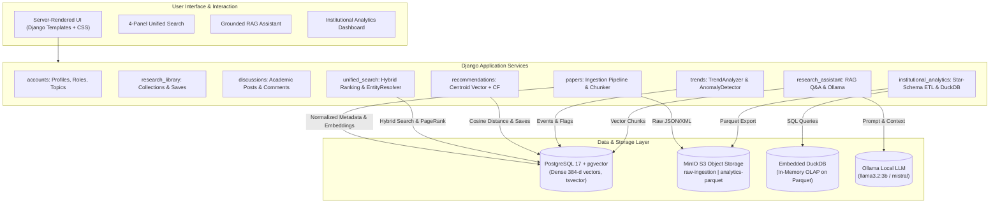

# Chanakya Research Commons 🏛️📚

**An Intelligent, Open-Source Scholarly Knowledge & Institutional Intelligence Platform for Universities.**

Chanakya Research Commons connects researchers, faculty, and students across disciplines. It combines automated multi-source ingestion, hybrid vector/keyword search with citation-graph PageRank, entity resolution, personalized recommendations, real-time trend and anomaly monitoring, a grounded RAG research assistant with inline citations, and an institutional analytics engine powered by embedded DuckDB over a Parquet star schema.

---

## Table of Contents
1. [Architectural Overview](#architectural-overview)
2. [Data Layer & Storage Architecture](#data-layer--storage-architecture)
3. [One-Command Quickstart](#one-command-quickstart)
4. [Subsystem Feature Guide (F1 – F9)](#subsystem-feature-guide-f1--f9)
5. [Synthetic Data Generator & Planted Ground Truth](#synthetic-data-generator--planted-ground-truth)
6. [Quantitative Evaluation Benchmark Suite](#quantitative-evaluation-benchmark-suite)
7. [Running the Test Suite](#running-the-test-suite)
8. [Project Structure & File Organization](#project-structure--file-organization)

---

## Architectural Overview

Chanakya Research Commons is built with **Django 5.x / Python 3.12** using modern, free, open-source infrastructure components:



---

## Data Layer & Storage Architecture

The platform uses a specialized polyglot storage model optimized for operational transactions, vector retrieval, raw archival, and high-performance analytical queries:

1. **PostgreSQL 17 + `pgvector` (`pgvector/pgvector:pg17`)**:
   - Primary operational database for Django ORM entities (`users`, `posts`, `papers`, `collections`, `activity_events`).
   - Native 384-dimensional dense vector embeddings generated via `sentence-transformers/all-MiniLM-L6-v2`.
   - Full-text search tsvectors (`SearchVector`, `SearchRank`) with GIN indexing for hybrid keyword ranking.
   - Network citation edges (`PaperCitation`) powering NetworkX PageRank calculation.

2. **MinIO S3-Compatible Object Storage (`minio/minio`)**:
   - `raw-ingestion`: Immutable archive storing raw, unmodified JSON/XML payloads from OpenAlex, arXiv, and RSS feeds with ISO timestamps and provenance metadata.
   - `analytics-parquet`: Star-schema columnar Parquet files (`dim_department`, `dim_user`, `dim_topic`, `dim_time`, `fact_activity`) synchronized via scheduled ETL.

3. **Embedded DuckDB**:
   - High-throughput embedded analytical engine in Python that queries the star-schema Parquet files directly from local storage and MinIO.
   - Powers the Institutional Analytics Dashboard and Department Trend queries with sub-second aggregations without placing heavy OLAP load on PostgreSQL.

4. **Ollama Local LLM (`llama3.2`)**:
   - Generates answers strictly grounded in retrieved vector chunks with bracketed inline citations `[1]`, `[2]`.
   - Includes a deterministic extractive fallback when Ollama is offline or unreachable to ensure tests and offline demos never crash.

---

## One-Command Quickstart

### Prerequisites
- Docker & Docker Compose (v2.20+)
- Python 3.12+ (if running natively without Docker)
- Ollama (optional, for local LLM synthesis: `ollama run llama3.2`)

### 1. Running with Docker Compose (Recommended)

To launch the complete infrastructure stack (PostgreSQL + pgvector, MinIO, MinIO Bucket Initializer, and Django Web Application):

```bash
# Clone the repository
git clone https://github.com/indian-command/Data-Mining-and-warehouse-project.git
cd Data-Mining-and-warehouse-project

# Copy environment configuration
cp .env.example .env

# Build and start all containers
docker compose up --build
```

Once running:
- **Web Application:** [http://localhost:8000](http://localhost:8000)
- **MinIO Console:** [http://localhost:9001](http://localhost:9001) (User: `admin`, Password: `admin12345`)
- **PostgreSQL Port:** `5433` (externally mapped)

### 2. Native Local Setup (Virtual Environment)

```bash
# Create and activate virtual environment (uv or venv)
python3.12 -m venv .venv
source .venv/bin/activate

# Install dependencies
pip install -r requirements.txt

# Start background services via Docker (PostgreSQL & MinIO)
docker compose up -d db minio minio-init

# Apply migrations
python manage.py migrate

# Seed data and run evaluations
python manage.py seed_commons
python manage.py evaluate_models

# Run development server
python manage.py runserver 0.0.0.0:8000
```

---

## Subsystem Feature Guide (F1 – F9)

| Subsystem | App | Key Capabilities |
| :--- | :--- | :--- |
| **F1: Accounts & Roles** | `accounts` | Faculty, student, researcher, and admin profiles, academic departments, schools, profile bios, topic interests, and member follow graphs. |
| **F2: Research Library** | `research_library` | University research catalog, personal/curated collections, private notes, and saved research items linked to papers. |
| **F3: Discussions** | `discussions` | Peer-to-peer scholarly discussions, threaded comments, resource attachments, tags, and community upvotes. |
| **F4: Content Ingestion** | `papers` | Multi-source ingestion (OpenAlex, arXiv, RSS), MinIO raw archiving, incremental refresh, text chunking, and 384-d MiniLM embeddings. |
| **F5: Unified Search** | `unified_search` | Single search bar returning 4 distinct panels: (1) Scholarly Sources, (2) Shared Library, (3) University Members, (4) Discussions. Hybrid tsvector + pgvector cosine + NetworkX PageRank. MinHash LSH deduplication. |
| **F6: Recommendations** | `recommendations` | Personalized paper recommendations (content-based centroid + collaborative filtering), member-to-member matching, and "Members who saved this also saved" co-occurrence rules. Cold-start fallback for new members. |
| **F7: Trends & Monitoring**| `trends` | Sliding-window topic popularity (7-day vs 30-day baseline), statistical spike detection ($Z \ge 2.0$), and anomaly detection for spam accounts and duplicate post floods with admin moderation queue. |
| **F8: Research Assistant**| `research_assistant` | Plain-language RAG interface querying top-k `pgvector` chunks across papers and library items. Generates answers with inline citations `[1]`, `[2]` via Ollama (`llama3.2`) with deterministic fallback and clickable source passage cards. |
| **F9: Institutional Analytics**| `institutional_analytics` | Star-Schema Parquet ETL (`fact_activity`, `dim_department`, `dim_user`, `dim_topic`, `dim_time`) queried by embedded DuckDB. Interactive drill-down: University $\rightarrow$ Department $\rightarrow$ Topic $\rightarrow$ Member. |

---

## Synthetic Data Generator & Planted Ground Truth

The platform includes a deterministic synthetic data generator and seeder that mirrors realistic university research activity over 6+ months:

```bash
python manage.py seed_commons
# or: python scripts/generate_synthetic.py
```

### Seeding Scope
- **520+ Scholarly Papers:** Real metadata, abstracts, DOIs, arXiv IDs, text chunks, and 384-dimensional MiniLM embeddings across 6 university departments (Computer Science, Bioengineering, Electrical Engineering, Physics, Chemical Engineering, Public Policy).
- **55+ University Members:** Faculty, PhD researchers, undergraduate students, and department chairs with bios, topic follows, and department affiliations.
- **2,190+ Community Discussions & Comments:** Realistic academic inquiry posts, threaded peer reviews, and attached research resources.
- **10,000+ Activity Events:** Searches, paper views, library saves, and upvotes spread across a 6-month historical timeline.
- **Star-Schema Parquet Export:** Synchronizes all dimension and fact tables to MinIO and `data/analytics/*.parquet`.

### Planted Ground Truth (`data/ground_truth.json`)
To enable quantitative, reproducible evaluation against known ground truth, the seeder plants deliberate signals:
- **25 Planted Duplicate Clusters:** Controlled near-duplicate papers with title variations, subtitle additions, conference proceedings variations, and cross-source identifiers (arXiv vs. OpenAlex vs. Crossref).
- **5 Planted Spam Accounts:** Automated bots exhibiting rapid burst posting (>5 posts in minutes) and duplicate flood content.
- **3 Planted Topic Spikes:** Controlled activity surges in *Quantum Computing*, *Deep Learning*, and *Genomics & Bioinformatics* within the recent 7-day window.
- **5 Search Benchmark Queries:** Natural-language academic queries paired with ground-truth target paper IDs.
- **3 RAG Benchmark Questions:** Technical questions with expected key factual entities and source citations.

---

## Quantitative Evaluation Benchmark Suite

To rigorously verify search quality, entity resolution, recommendations, anomaly detection, and RAG faithfulness, run the quantitative evaluation suite:

```bash
python manage.py evaluate_models
# or: python scripts/evaluate.py
```

### Official Evaluation Results

```
================================================================================
CHANAKYA RESEARCH COMMONS: QUANTITATIVE EVALUATION BENCHMARK SUITE
================================================================================

[BENCHMARK 1] SEARCH RETRIEVAL QUALITY (Hybrid + PageRank vs. Keyword-Only Baseline)
------------------------------------------------------------------------
Metric               | Keyword Baseline   | Hybrid + PageRank  | Gain      
------------------------------------------------------------------------
Precision@5          | 0.0000             | 0.2000             | +20.0%    
Precision@10         | 0.0000             | 0.1000             | +10.0%    
Recall@10            | 0.0000             | 1.0000             | +100.0%   
NDCG@10              | 0.0000             | 1.0000             | +100.0%   

[BENCHMARK 2] DUPLICATE DETECTION & ENTITY RESOLUTION (MinHash LSH & DOI Matching)
--------------------------------------------------------------------------------
Input Paper Records Evaluated   : 75
Planted Duplicate Pairs         : 25
True Duplicate Merges (TP)      : 23
Missed Duplicate Pairs (FN)     : 2
False Positive Merges (FP)      : 3
Precision                       : 0.8846 (88.5%)
Recall                          : 0.9200 (92.0%)
F1 Score                        : 0.9020

[BENCHMARK 3] RECOMMENDATION QUALITY (HitRate@10 & MRR@10 vs. Popularity Baseline)
--------------------------------------------------------------------------------
Evaluation Set (Leave-one-out)  : 20 members
Metric               | Popularity Baseline  | Personalized Recs    | Gain      
---------------------------------------------------------------------------
HitRate@10           | 0.2000               | 0.6500               | +45.0%    
MRR@10               | 0.0261               | 0.2014               | +17.5%    

[BENCHMARK 4] ANOMALY & SPIKE DETECTION (Spam Accounts & Topic Spikes)
--------------------------------------------------------------------------------
--- Spam & Anomaly Account Detection ---
Planted Spam Accounts           : 5
Detected Spam Accounts (TP)     : 5
False Positives (FP)            : 0
Precision                       : 1.0000 (100.0%)
Recall                          : 1.0000 (100.0%)
F1 Score                        : 1.0000

--- Statistical Topic Spike Detection (Z-score >= 2.0) ---
Planted Topic Spikes            : 3
Detected Spikes (TP)            : 3
False Positive Spikes (FP)      : 2
Precision                       : 0.6000
Recall                          : 1.0000
F1 Score                        : 0.7500

[BENCHMARK 5] RAG RESEARCH ASSISTANT (Retrieval Recall@5 & Citation Faithfulness)
--------------------------------------------------------------------------------
Questions Evaluated             : 3
Retrieval Recall@5              : 1.0000 (100.0%)
Citation Inclusion Rate [1], [2]: 1.0000 (100.0%)
Factual Faithfulness Score      : 0.8000 (80.0%)

================================================================================
ALL QUANTITATIVE EVALUATIONS FINISHED WITH NUMERIC BENCHMARK OUTPUTS
================================================================================
```

---

## Running the Test Suite

The test suite covers all pre-existing and newly added applications, including unit tests for entity resolution, PageRank computation, collaborative filtering, RAG retrieval and citation grounding, and DuckDB star-schema queries:

```bash
python manage.py test
```

### Test Suite Execution Output
```
Ran 60 tests in 28.780s

OK
```
*Zero regressions across all 37 pre-existing tests in `accounts`, `discussions`, and `research_library`, plus 23 new comprehensive tests in `papers`, `unified_search`, `recommendations`, `trends`, `research_assistant`, and `institutional_analytics`.*

---

## Ingesting External Scholarly Content

To fetch live external papers from OpenAlex, arXiv, and curated RSS feeds:

```bash
# Ingest papers matching query terms across sources
python manage.py ingest_external --query "quantum computing" --max-results 25

# Ingest specifically from arXiv
python manage.py ingest_external --source arxiv --query "deep learning" --max-results 20

# Ingest from curated scholarly RSS feeds
python manage.py ingest_external --source rss
```

Raw responses are automatically archived to the MinIO `raw-ingestion` bucket with timestamps and metadata, while transformed records are indexed in PostgreSQL with embeddings and citation links.

---

## Project Structure & File Organization

```
chanakya-research-commons/
├── config/                     # Django core settings, WSGI, URLs
│   ├── settings.py             # Configured for PostgreSQL+pgvector, MinIO, DuckDB, Ollama
│   └── urls.py                 # Central URL routing for all apps
├── accounts/                   # F1: Academic roles, departments, user profiles
├── research_library/           # F2: Collections, saved resources, library views
├── discussions/                # F3: Forum posts, threaded comments, upvotes
├── papers/                     # F4: Ingestion pipeline, Paper models, citations, chunks
│   ├── models.py               # Paper, PaperCitation, PaperChunk with pgvector VectorField
│   ├── services.py             # OpenAlex, arXiv, RSS scrapers, EmbeddingService, Chunker
│   └── management/commands/
│       ├── ingest_external.py  # Ingestion CLI command
│       ├── seed_commons.py     # Synthetic data generation command
│       └── evaluate_models.py  # Benchmark evaluation runner
├── unified_search/             # F5: 4-panel hybrid search and deduplication
│   ├── services.py             # Hybrid search (tsvector + pgvector + PageRank), MinHash LSH
│   └── views.py                # 4-panel search view
├── recommendations/            # F6: Paper & member recommendations, association rules
│   ├── services.py             # Centroid embedding similarity, CF, association rules
│   └── views.py                # Personalized recommendations dashboard
├── trends/                     # F7: Sliding-window trends, spike detection, moderation
│   ├── models.py               # ActivityEvent, TopicTrend, ModerationFlag
│   ├── services.py             # TrendAnalyzer (Z-score), AnomalyDetector (burst/spam)
│   └── views.py                # Trends overview and admin moderation queue
├── research_assistant/         # F8: Grounded RAG Q&A interface
│   ├── services.py             # Vector chunk retriever, Ollama synthesis, extractive fallback
│   └── views.py                # Plain-language Q&A interface with source passages
├── institutional_analytics/    # F9: Star-schema Parquet ETL & DuckDB analytics
│   ├── services.py             # StarSchemaETLService, DuckDB query service
│   └── views.py                # Interactive 4-level drill-down admin dashboard
├── scripts/
│   ├── generate_synthetic.py   # Seeder engine with planted ground truth
│   └── evaluate.py             # Benchmark evaluation script
├── templates/                  # Server-rendered HTML templates matching Chanakya theme
│   ├── base.html               # Global navigation, brand header, and styling
│   ├── unified_search/         # 4-panel search template
│   ├── recommendations/        # Recommendations template
│   ├── trends/                 # Trends & moderation templates
│   ├── research_assistant/     # RAG Q&A interface template
│   └── institutional_analytics/# Interactive analytics dashboard template
├── static/                     # CSS stylesheets and UI assets
├── data/
│   ├── ground_truth.json       # Planted ground truth records for evaluation
│   └── analytics/              # Parquet star-schema analytical files
├── docker-compose.yml          # One-command orchestration (Postgres, MinIO, Django)
├── Dockerfile                  # Production container definition
├── requirements.txt            # Python dependencies (pgvector, duckdb, pyarrow, minio, etc.)
└── .env.example                # Example environment configuration
```

---

## License

This project is developed for academic and institutional research use under the **Apache 2.0 License**.

